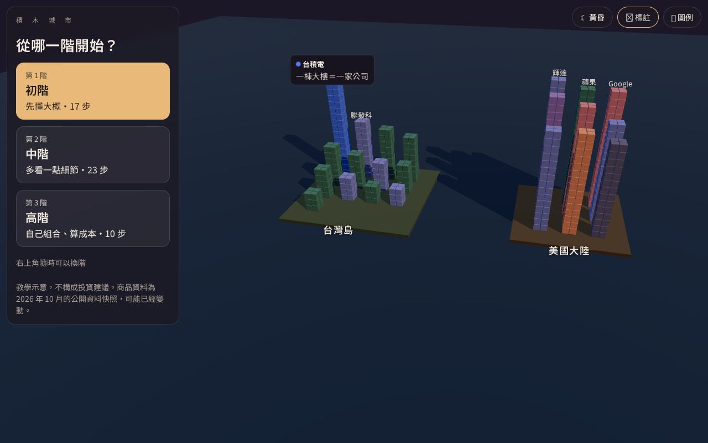
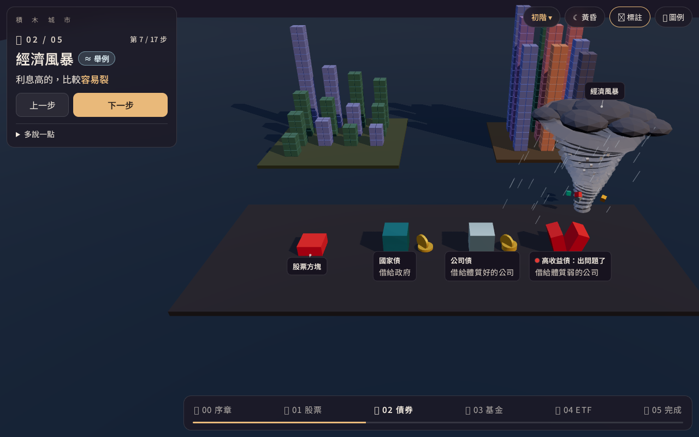
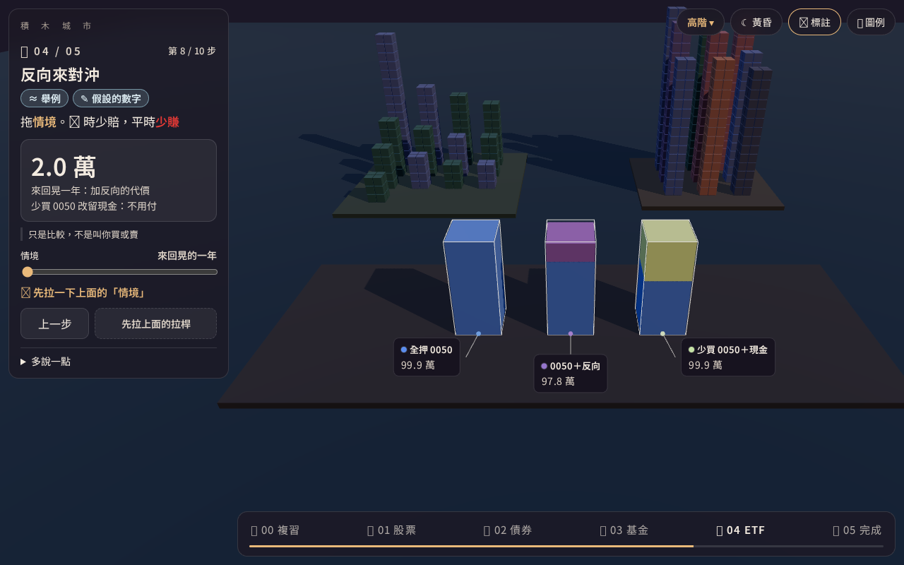

# Brickonomics（積木城市）

An interactive 3D course that explains **stocks, bonds, funds and ETFs** with toy blocks — for people who have never invested and get tired of reading. The interface is in Traditional Chinese.



- **One company = one tower of blocks.** Buying a stock means taking one block home.
- **A bond is an IOU** that drips coins; **a fund** is an excavator that picks blocks for you (and charges a meter); **an ETF** is built automatically from a blueprint.
- **Cut and explode** any basket with a laser knife to see what's inside — weights are real, from a dated public-data snapshot.
- **Financial events are weather:** 🌪 tornado = recession, ⚡ lightning = one company in trouble, 🌋 earthquake = market crash, ❄️ cold front = rate rise, ☀️ heat wave = inflation, 🌤 sunshine = long-term growth, 🌊 waves = choppy markets.

| Economic storm | Hedging with an inverse ETF (advanced) |
|---|---|
|  |  |

## Three tiers

| Tier | Question it answers | Steps |
|---|---|---|
| 初階 Beginner | What is it? | 17 |
| 中階 Intermediate | How do I compare? (drawdown, P/E, rates vs bond prices, inflation, dollar-cost averaging, fees) | 23 |
| 高階 Advanced | How do I combine and control risk? (portfolio mix, correlation, day-trading costs, duration, 30-year fee drag, leveraged-ETF decay, hedging, rebalancing) | 10 |

Each step shows a short title, one plain sentence and one big number; details stay folded under 「多說一點」. Copy follows a Chinese adaptation of ASD-STE100 (one word per meaning, one idea per sentence) and a 3Blue1Brown-style pacing (camera first, then words; keywords coloured like the object they name). Every tier was usability-tested with simulated personas.

## Honesty rules

- Every number is computed from data or a documented simulation. Illustrative numbers are marked **≈**, assumptions **✎**, and data not yet checked against a primary source **？** (derived automatically).
- No investment advice; comparison steps say so on screen. No futures, options or margin.
- Sources and verification dates: [`docs/data-sources.md`](docs/data-sources.md).

> 教學示意，不構成投資建議。商品資料為 2026 年 10 月的公開資料快照，可能已經變動。
> Educational illustration only — not investment advice. Product data is a public-data snapshot from October 2026 and may be out of date.

## Run locally

```bash
npm install
npm run dev          # http://localhost:5173
npm test             # unit tests (Vitest)
npm run e2e          # end-to-end tests (Playwright)
npm run build        # production build + check that dev-only code is not shipped
```

Useful URLs: `?course=beginner|intermediate|advanced&step=<id>`, `?theme=day`, `?mode=sandbox`, `?quality=low`, `?fallback=1` (text-only version).

## Tech

Vite · TypeScript · React 19 · three.js / React Three Fiber · drei · zustand · Vitest · Playwright. Render-on-demand, quality fallback, reduced-motion support and a text-only fallback when WebGL is unavailable.

## License

[MIT](LICENSE)
